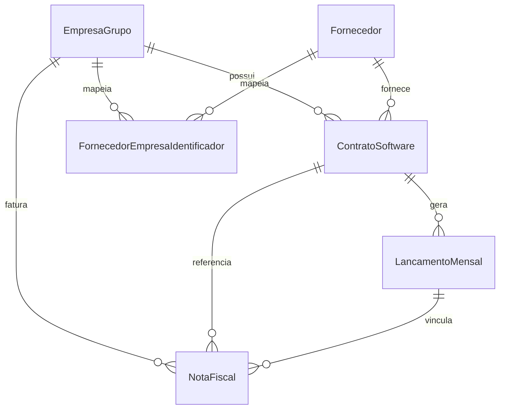

# ControleNF - Sistema de Gestão e Controle de Notas Fiscais e Contratos

[](https://fastapi.tiangolo.com)
[](https://www.python.org/)
[](https://www.sqlite.org/)
[](https://www.chartjs.org/)

Sistema corporativo desenvolvido para centralizar, auditar e automatizar o ciclo de vida de contratos de software (SaaS, licenças e telecom) e o recebimento de notas fiscais nas **9 empresas do Grupo Emalto**.

---

## 🎯 Problema de Negócio & Motivação

Antes da implementação do **ControleNF**, a gestão de contratos de TI e conferência de notas fiscais ocorria por meio de planilhas manuais descentralizadas no Excel. Esse cenário gerava sérios gargalos operacionais:

1. **Inconsistência de Códigos por Filial:** Um mesmo fornecedor (ex.: TOTVS ou KTREE) possui códigos de cadastro contábil distintos dependendo da empresa do grupo pagadora (EIM, EEM, EEN, Torque, etc.). Erros de digitação geravam atrasos na conciliação e pré-lançamentos fiscais incorretos.
2. **Falta de Imutabilidade Histórica:** Alterar o cadastro mestre de um fornecedor retroagia nas planilhas e distorcia o histórico contábil de meses já fechados e auditados.
3. **Falta de Visibilidade em Lote e Vencimentos:** Dificuldade em monitorar quais contratos mensais já haviam emitido suas respectivas notas no mês corrente, acarretando multas por atraso ou pagamentos em duplicidade.
4. **Complexidade de Contratos Multi-Proposta (TOTVS):** A TOTVS possui dezenas de contratos ativos (Full, BackOffice, Transmite, etc.) com cancelamentos programados e valores que precisavam de rastreabilidade unitária.

---

## 🚀 Solução Proposta

O **ControleNF** migrou a governança para uma aplicação web centralizada, introduzindo:

- **Fonte Única de Verdade (SSOT):** Módulo central de *Cadastros Base* com suporte a mapeamento mestre por empresa e gerenciamento granular de propostas da TOTVS.
- **Snapshotting Contábil:** No momento do registro da NF, o sistema "fotografa" os códigos de fornecedor e contrato vigentes, garantindo imutabilidade histórica mesmo se o cadastro mestre for alterado no futuro.
- **Matriz Anual Automatizada (12 Meses):** Geração preditiva de lançamentos mensais com auto-vinculação inteligente de notas fiscais ao slot correspondente.
- **Auditoria e Soft Delete:** Tratamento de cancelamentos e encerramentos programados de contratos sem quebrar integridade referencial com lançamentos legados.
- **Notificações Ativas:** Monitoramento automatizado via Windows Task Scheduler com disparo de notificações nativas (Toast) de pendências diárias.

---

## 📊 Métricas do Sistema em Produção (2026)

- **9 Empresas do Grupo Atendidas:** EIM, EEM, EEN, Fundação Emalto, Torque Diesel, Torque Diesel Filial, Torque Grill, Torque Pneus e Agronegócios.
- **28 Fornecedores Monitorados:** TOTVS, KTREE, Junsoft, SysAid, Vero, Vivo, Google Cloud, Interponto, Netsol, Mak Solutions, Starlink, WebPosto, entre outros.
- **64 Contratos de Software Ativos.**
- **744 Lançamentos Mensais Gerenciados na Matriz Anual.**
- **+400 Notas Fiscais Processadas e Auditadas.**

---

## 🛠️ Arquitetura e Tecnologias

### Backend
- **FastAPI (Python 3.10+):** Framework assíncrono para construção de API RESTful com documentação OpenAPI/Swagger automática.
- **SQLAlchemy 2.0:** ORM robusto com relacionamentos bidirecionais e restrições de integridade.
- **Pydantic V2:** Validação estrita de schemas de entrada e saída com tipagem forte.
- **SQLite com modo WAL (Write-Ahead Logging):** Alta concorrência para leitura/escrita em rede corporativa sem locks destrutivos.
- **OpenPyXL:** Exportação de relatórios gerenciais e conciliação para planilhas corporativas (.xlsx).
- **Plyer & PowerShell:** Mecanismo híbrido de envio de notificações Toast no Windows Desktop.

### Frontend
- **Arquitetura SPA (Single Page Application):** Interface leve e responsiva em Vanilla JavaScript, HTML5 semântico e CSS3 modular.
- **Chart.js:** Visualização de KPIs financeiros, despesas por empresa e projeção de gastos.
- **Camada de Serviço Assíncrona (`api.js`):** Abstração centralizada de chamadas RESTful com tratamento global de erros.

---

## 🗄️ Modelo de Dados Principal



- `empresas_grupo`: Cadastro das filiais e razões sociais do grupo.
- `fornecedores`: Fornecedores categorizados em softwares mensais ou avulsos.
- `fornecedor_empresa_identificador`: Matriz "De/Para" de códigos entre Fornecedor e Filial.
- `contratos_software`: Metadados do contrato (vigência, valor, dia de vencimento, soft-delete).
- `lancamentos_mensais`: Slots mensais (Jan-Dez) pré-computados com ajuste para dias úteis.
- `notas_fiscais`: Registro com snapshot dos dados de faturamento, protocolo e status da pré-nota.

---

## ⚙️ Instalação e Execução

### Pré-requisitos
- Windows 10/11 ou Windows Server
- Python 3.10 ou superior

### Execução Rápida (Windows)
Basta executar com dois cliques o arquivo:
```cmd
INICIAR_SISTEMA.bat
```
O script irá:
1. Criar o ambiente virtual (`venv`) caso não exista.
2. Atualizar e instalar todas as dependências do `requirements.txt`.
3. Criar os bancos SQLite e aplicar as migrações/seeds iniciais se necessário.
4. Descobrir automaticamente o IP local da máquina na rede corporativa.
5. Iniciar o servidor Uvicorn na porta `8050`.

Acesse no navegador:
- **Local:** `http://localhost:8050`
- **Rede Local:** `http://<IP_DA_MAQUINA>:8050`
- **Documentação da API:** `http://localhost:8050/docs`

---

## 📅 Rotinas de Automação

- **Notificações Diárias (`scripts/notificacao_diaria.py`):** Roda diariamente via Agendador de Tarefas do Windows às 07:00, alertando os usuários sobre notas vencidas ou a vencer na semana.
- **Rotação Anual (`scripts/rotacao_anual.py`):** Script executado na virada do ano fiscal para arquivar o banco do ano anterior na pasta de backups e instanciar um novo banco anual já populado com os contratos vigentes e os 12 slots mensais pré-calculados.

---

## 👤 Autor

**Pedro Martins**  
Estagiário de Tecnologia da Informação - Grupo Emalto
